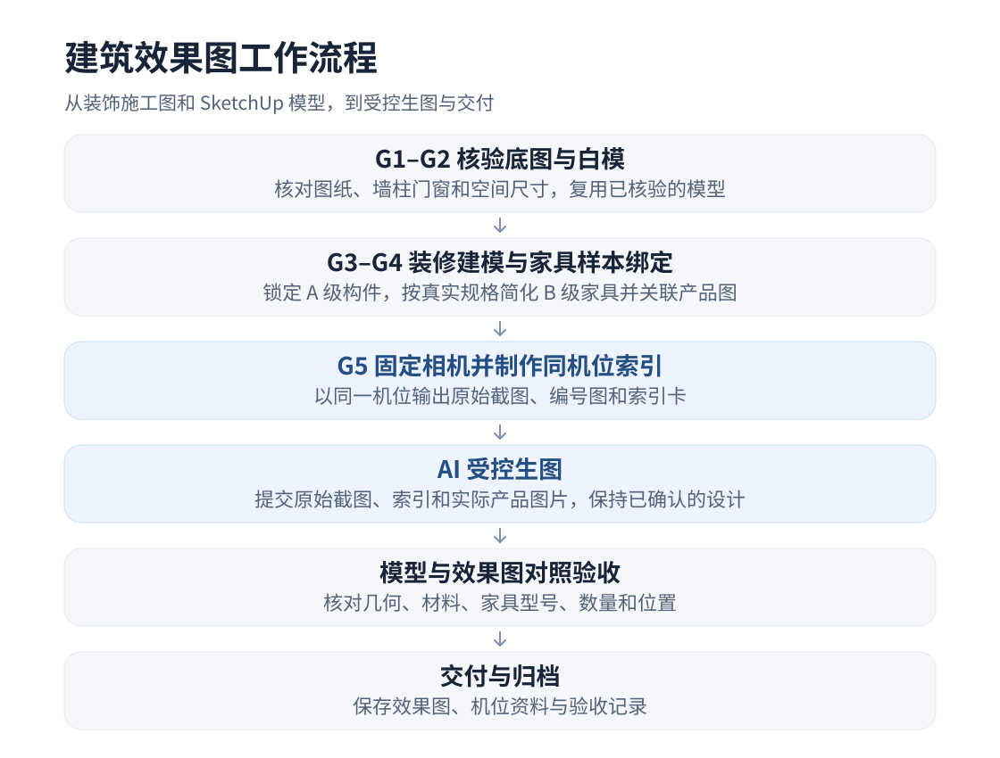

# 建筑效果图 Skill

用传统装饰施工图去生成su简单建模，通过固定的机位视角生成建筑效果图。可加入真实家具产品样本（图片或电商链接），制作和验收受控建筑效果图。适用于建筑装饰室内项目，可从已有模型继续。

## 工作流程

需安装SketchUp-MCP。（需根据本机su版本安装） 

先将装饰施工图手动处理成可导入su的条件图（包含墙门柱），调用skill，把附带装饰原始施工图（建议），原始施工图PDF，su条件图的文件夹发给你的AI。已有 SketchUp 模型、样本卡或验收记录时，先核对它们是否仍对应当前版本，再从最早受影响的阶段续作。遇到缺失或冲突时，记录问题并暂停受影响的部分，其他机位或构件可继续。

**暂停与返工**。生图资料缺失或机位不一致时，暂停受影响的机位，补齐或确认后从相应阶段续作。验收发现 P0 或待修的 P1 问题时，定位并修正受影响的阶段，再复验。

| 阶段 | 核查与产出 |
| --- | --- |
| G1 核验底图 | 核对 CAD/PDF 版本、单位、比例、坐标及墙柱和门窗位置。 |
| G2 核验白模 | 对照图纸检查空间轮廓、洞口、楼板和主要固定构件，复用已核验的几何。 |
| G3 装修与家具 | 按设计依据锁定 A 级构件。B 级活动家具按确认产品的真实规格简化建模，并填写[家具样本卡](controlled-archviz/references/furniture-sample-card.md)。 |
| G4 绑定语义与样本 | 核对 `Component ID`、`Name`、`Geometry Lock` 三个语义字段，以及 B 级家具的尺寸、型号和产品图片。 |
| G5 固定相机与索引 | 为每个机位准备原始截图、同机位编号图和[索引卡](controlled-archviz/references/same-view-index-card.md)。相机变化后重做受影响机位的索引。 |
| 正式生图 | 同时提交原始截图、同机位索引及实际产品图片，保持已确认的几何、材料、家具型号和布置。 |
| 验收与交付 | 用[验收模板](controlled-archviz/references/acceptance.md)对照模型、同机位资料、产品样本和效果图。P0 阻止交付，P1 修正后交付，P2 记为一般视觉优化。 |

只交付单机位图片时，B 级家具的图像优化无需回写模型。多机位共用模型和产品样本，各自建立索引和验收记录，并复核跨机位的一致性。若同时交付模型，还需核查主要家具和固定装修在模型中有对应成果。

流程依据见[受控交付标准 V2.1（公开版）](controlled-archviz/references/standard-v2.1.md)。每次完成阶段或暂停时更新[续作记录](controlled-archviz/references/checkpoint.md)。

## 安装

下载本仓库后，对AI说帮我安装skill+`controlled-archviz` 文件夹地址。

下载本仓库后，将完整的 `controlled-archviz` 文件夹复制到 `~/.agents/skills/`。Windows 可在资源管理器中打开 `%USERPROFILE%\.agents\skills`。复制后，`controlled-archviz/SKILL.md` 应直接位于该技能文件夹中。已有同名技能时，可先比较版本再决定是否替换。

## 调用

- ChatGPT Work 桌面端使用本机文件的会话中，输入 `@` 搜索「建筑效果图 Skill」。
- Codex CLI 输入 `$controlled-archviz`，或使用 `/skills` 查找。

可以在选中技能后发送：

> 按 V2.1 接续这个 SketchUp 模型的单机位效果图。先只读检查现有模型、设计图纸、机位截图和家具样本，说明能从哪一步继续，以及需要补齐的输入。

SketchUp 操作取决于当前环境提供的 MCP 能力。公开版仅包含说明和模板。
